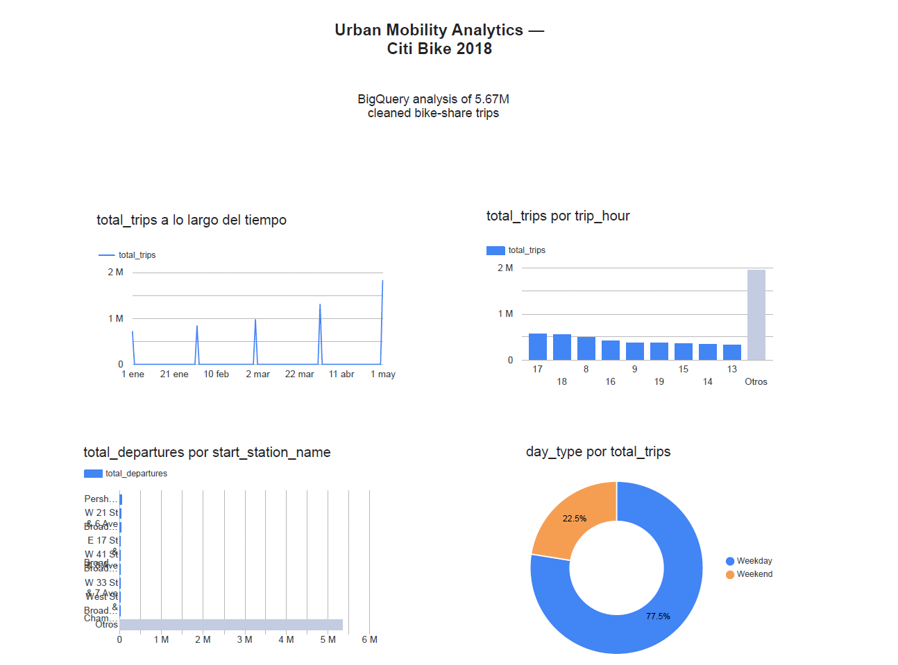

# Urban Mobility Analytics with GCP BigQuery

An end-to-end analytics project built in Google Cloud BigQuery using New York Citi Bike public trip data. The project demonstrates how to transform large public data into reusable analytical tables and extract operational insights using SQL.

## Business objective

Understand how bike-sharing demand varies by time, station, route and customer type in order to support operational decisions such as bike allocation, station capacity planning and demand monitoring.

## Results

The project processes **5,671,033** valid Citi Bike trips from 2018.

Key findings:

- **May 2018** had the highest recorded demand, with **1,824,710 trips**.
- Demand peaked at **17:00**, with **565,551 trips**, indicating a pronounced late-afternoon usage peak.
- **Weekdays** accounted for **4,397,650 trips**, with an average duration of **15.20 minutes**.
- **Weekends** accounted for **1,273,383 trips**, with longer average journeys of **19.66 minutes**.
- **Pershing Square North** was the busiest departure station.
- The most frequent route was **E 7 St & Avenue A → Cooper Square & Astor Pl**.

These findings are descriptive and based on the public 2018 dataset; they do not establish causal relationships.

## BigQuery ML: station segmentation

The project extends the SQL analytics workflow with a BigQuery ML K-means model that segments departure stations using total departures, average trip duration, subscriber share and customer share. Features are standardised before training so that high-volume stations do not dominate the clustering solely because of scale.

The four-cluster model achieved a Davies-Bouldin Index of **1.278**. This is used as an exploratory quality indicator rather than a universal pass/fail threshold.

| Segment | Stations | Average departures | Average duration | Interpretation |
|---|---:|---:|---:|---|
| 1 | 160 | 18,043 | 13.28 min | High-throughput, short-trip stations |
| 4 | 53 | 7,520 | 69.58 min | Lower-volume stations associated with long trips |
| 2 | 363 | 4,605 | 15.29 min | Moderate-volume, short-trip stations |
| 3 | 199 | 3,586 | 25.60 min | Moderate-volume stations with longer trips |

The segments describe patterns in the source data; they do not establish why a station belongs to a particular group.

## Dashboard

The project includes a Looker Studio dashboard connected to the BigQuery analytical tables. It presents monthly demand, hourly usage, the busiest departure stations and the weekday/weekend split.



## Architecture

```text
BigQuery public dataset
        │
        ▼
trips_2018_stage
(cleaned 2018 trip-level data)
        │
        ├── monthly_trip_summary
        ├── station_trip_summary
        ├── route_trip_summary
        ├── hourly_trip_summary
        ├── day_type_summary
        └── monthly_trip_trends
```

## Data processing

The staging layer:

- filters trips to 2018;
- removes non-positive trip durations;
- removes records without an origin or destination station;
- converts source fields into analysis-ready columns;
- calculates trip duration in minutes.

The downstream tables aggregate the cleaned data for temporal, spatial and user-type analysis.

## Project structure

```text
gcp-bigquery-urban-mobility/
├── sql/
│   ├── 01_create_stage_table.sql
│   ├── 02_monthly_trip_summary.sql
│   ├── 03_station_trip_summary.sql
│   ├── 04_route_trip_summary.sql
│   ├── 05_hourly_trip_summary.sql
│   ├── 06_day_type_summary.sql
│   ├── 07_monthly_trip_trends.sql
│   ├── 08_train_station_segments_bqml.sql
│   ├── 09_evaluate_station_segments_bqml.sql
│   └── 10_assign_station_segments_bqml.sql
├── docs/
├── .gitignore
└── README.md
```

## How to run

1. Create a Google Cloud project and open BigQuery Studio.
2. Create a dataset named `mobility_analytics` in the `US` region.
3. Run the SQL files in numerical order.
4. Explore the generated analytical tables in BigQuery.

The queries use the public dataset:

```text
bigquery-public-data.new_york_citibike.citibike_trips
```

## SQL techniques demonstrated

- Layered data design with staging and aggregate layers
- `CREATE OR REPLACE TABLE`
- Data quality filtering
- Date and time transformations with `DATE`, `DATE_TRUNC` and `EXTRACT`
- Conditional aggregation with `COUNTIF`
- Grouping and aggregation
- Window functions with `LAG`
- Safe numerical calculations with `SAFE_DIVIDE`
- BigQuery ML K-means clustering, evaluation and station-level segment assignment

## Technology

- Google Cloud Platform
- BigQuery
- BigQuery ML
- SQL
- Git and GitHub

## Limitations and next steps

- The source is public historical data and reflects a specific city and period.
- Results are descriptive rather than causal.
- A production solution should automate ingestion, monitor data quality and control query costs.
- Future work could add a Looker Studio dashboard, scheduled queries and machine-learning experimentation with Vertex AI.
